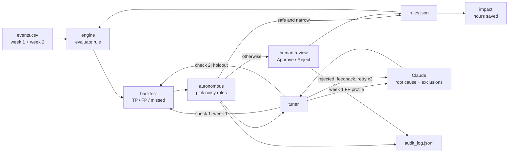

# SIEM Tuning Agent

An AI agent that owns SIEM detection-rule tuning end to end. Built for the HUMAIN x Misk
hackathon, Challenge 3: Autonomous Enterprise.

SOC analysts lose hours every week triaging alerts from noisy rules. This agent:

1. finds rules with a high false-positive rate,
2. diagnoses the root cause in plain English with Claude,
3. proposes narrow exclusions,
4. proves each proposal is safe: a backtest on week 1 (training) and a validation on week 2,
   a holdout the agent never sees. Any hidden attack means rejection and a retry with
   feedback, up to 3 attempts,
5. auto-applies only provably safe changes, queues the rest for a human, and writes every
   decision to an audit log.

On the bundled data it removes about 96% of false positives (325 alerts and 54 analyst
hours per week at 10 minutes per alert) while still catching 34 of 34 attacks.

## Setup

```bash
python3 -m venv venv && source venv/bin/activate
pip install -r requirements.txt
echo "ANTHROPIC_API_KEY=sk-ant-..." > .env
python data/generate_events.py        # optional: regenerate data/events.csv (fixed seed)
```

## Commands

| Command | What it does | Calls Claude | Writes rules.json |
|---|---|---|---|
| `python -m agent.engine` | Alert count per rule | No | No |
| `python -m agent.backtest` | TP, FP, FP rate and missed attacks, on all data and per week | No | No |
| `python -m agent.tuner` | Tunes the noisiest rule with holdout validation and prints the safety check log | Yes | No |
| `python -m agent.tuner R2` | Same, for one rule | Yes | No |
| `python -m agent.autonomous` | Tunes every rule above 30% week 1 FP rate and auto-applies the safe changes | Yes | Yes |
| `python -m agent.autonomous --threshold 0.5` | Same, with a different threshold | Yes | Yes |
| `python -m agent.autonomous --propose-only` | Tunes but never auto-applies; everything is queued | Yes | No |
| `python -m agent.autonomous --demo-inject` | Forces a risky first proposal on R3 (see below) | Yes | Yes |
| `python -m agent.impact` | Business impact of the current rules.json | No | No |
| `streamlit run app.py` | The dashboard | On button click | On run or approval |
| `python -m eval.run_eval` | Full evaluation (see below) | Yes | No |
| `python -m pytest` | Unit and regression tests | No | No |

To start over, use "Reset rules and audit log" in the dashboard sidebar. It empties every
rule's exclusions, clears `data/audit_log.jsonl`, and so also clears "Already tuned".

## Demo script

1. `streamlit run app.py`. The **Live Agent** tab shows all three rules as Noisy, at about
   95% false positives.
2. In the sidebar, tick **Demo: inject risky proposal**. Leave **Step-by-step animation** on.
3. Click **Run autonomous tuning on all rules**. Each rule's tracker steps through detect,
   diagnose, propose, backtest, holdout and apply as the agent works.
4. On the impossible travel rule, the injected "exclude all VPN logins" passes week 1. It
   then fails the unseen holdout, and a red **UNSAFE CHANGE BLOCKED** banner appears. The
   card shows the real attack the change would have silenced, and Claude retries with a
   narrower exclusion that passes every gate.
5. **Safety & Audit** shows the blocked proposal, the live rule diffs and the audit log.
   **Impact** shows analyst hours saved, and the triage-time slider changes it.
6. **Evaluation** reads `eval/results.json`. It shows the ablations, run-to-run variance and
   the regression check, including the adversarial failure. **How it works** shows the
   architecture.
7. Click run again: every rule shows Already tuned and is skipped. Use **Reset rules and
   audit log** to replay the demo.

## Architecture



| Module | Role |
|---|---|
| `agent/engine.py` | Evaluates a rule. Conditions are ANDed. Each exclusion is a group of ANDed conditions, and any matching group suppresses the event. |
| `agent/backtest.py` | Scores a rule against the `is_malicious` labels. Splits the weeks, compares before and after, and names the exclusion that hid an attack. |
| `agent/tuner.py` | The Claude loop. It sends only week 1 false positives, gets a root cause and exclusions as schema-checked JSON, runs both safety checks, and retries with feedback. |
| `agent/autonomous.py` | Picks noisy rules, skips rules that are already tuned, decides auto-apply, queue or reject, and writes the audit log. |
| `agent/audit.py` | Append-only JSONL audit log. |
| `agent/impact.py` | Alerts removed and analyst hours saved per week, noise reduction, and attacks caught. |
| `app.py`, `ui/` | Streamlit dashboard. `ui/theme.py` holds the dark theme and color tokens, `ui/components.py` the HTML cards, `ui/charts.py` the Altair charts, `ui/agent_view.py` the animated live run, and `ui/tabs.py` the other tabs. `.streamlit/config.toml` sets the base theme. |

**Safety design**

- A change is auto-applied only if it hides 0 attacks in week 1, hides 0 attacks in the
  holdout, and every exclusion group has at least 2 ANDed conditions. More conditions make
  an exclusion narrower.
- Claude never sees holdout data. When the holdout fails, the feedback names the
  exclusion that was too broad, not the attack it hid.
- Claude cannot use the label, week, or timestamp fields in exclusions.
- Nothing is applied silently. Each auto-apply, queue, rejection, and human decision is
  logged with before and after metrics for both weeks.

**Model:** `claude-sonnet-5-5`, with structured JSON output. Server-side refusal fallback
is enabled, so if a safety classifier declines a request, it is rerun on a fallback model.

**Data:** `data/generate_events.py` creates two weeks of synthetic events for three rules:
brute force, encoded PowerShell, and impossible travel. Each rule has:
- a large benign source that is safe to exclude,
- some messy benign noise that cannot be excluded safely,
- "trap" attacks that share field values with the noise, so a broad exclusion hides
  them. Some traps appear only in week 2.

## Evaluation

Reproduce everything with one command (needs the API key; costs a few dollars, about 10 minutes):

```bash
python -m eval.run_eval
```

It regenerates three unseen datasets (`data/generate_unseen.py`, fixed seeds: same
distribution, shifted noise, adversarial traps). It tunes the bare rules on each dataset's
week 1 with four variants and scores them on week 3, a test week no variant ever touches.
Week 2 is the full agent's validation gate. The variants are:

- **A:** no agent (bare rules).
- **B:** heuristic, excluding the most frequent false-positive value with no LLM.
- **C:** the agent without holdout validation.
- **D:** the full agent.

The LLM variants run 3 times each to show run-to-run variance. The script also re-checks
previously accepted rules on every dataset and runs the pytest suite. Results go to
`eval/results.json`, and the tables to [eval/REPORT.md](eval/REPORT.md).

```bash
python -m eval.run_eval --runs 1 --datasets same    # quick smoke run
python -m eval.run_eval --report-only               # rebuild REPORT.md from results.json
python -m pytest                                    # unit and regression tests only, no API
```

## Limitations & Roadmap

**Limitations today**

- **Synthetic data.** The noise patterns are cleaner than a real SOC's, and the labels are
  perfect. Real dispositions are delayed, incomplete, and sometimes wrong.
- **Small holdout.** One week with 4 to 8 attacks per rule gives weak statistical
  confidence. A rare attack pattern can be missed by both weeks.
- **Simple rule language.** Rules are field comparisons only, with no aggregations, time
  windows, or joins.
- **FP rate on few alerts.** After tuning, a rule can still read 40 to 50% FP rate because
  only about 15 alerts remain, so the threshold needs care.
- **Already tuned is permanent until reset.** New data does not trigger re-tuning yet.
- **Single-user local files.** rules.json and the audit log have no locking, versioning,
  or access control.

**Roadmap**

- **Real SIEM integration.** Pull rules, alerts, and analyst dispositions from Microsoft
  Sentinel, Splunk, or Elastic through their APIs. Use closed-as-benign and closed-as-true-positive
  tickets as labels, and push approved changes back through the SIEM's API or a pull
  request on a detection-as-code repo.
- **KQL export.** Translate a rule and its exclusions into a Sentinel KQL query, with each
  exclusion group as a `where not(...)` clause, so analysts can review and deploy the
  change in their native language. SPL for Splunk would follow the same pattern.
- **Human-feedback learning.** Feed past human approvals and rejections from the audit log
  back to the agent as examples, so it learns each team's risk appetite. For example, it
  could learn never to exclude service accounts or to always pin exclusions to a host.
  Track the approval rate as a quality metric.
- **Continuous operation.** Run on a schedule, re-validate live exclusions against new
  weeks of data, and roll back an exclusion automatically if it starts hiding attacks.
